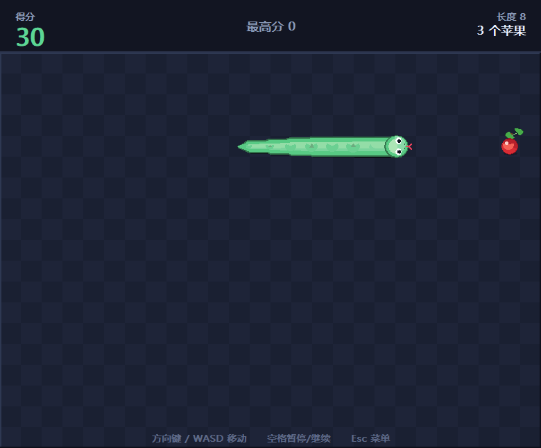

# 贪吃蛇 3.0

用 C 语言 + Win32 GDI 写的**图形窗口版**贪吃蛇。
完全重写，和前面两版的控制台字符版没有共用代码。



## 直接玩

**不用编译、不用装任何东西**，双击即可：

```
build\Snake3.exe
```

Windows 10 / 11 直接运行。想发给朋友，只发 `Snake3.exe` 这一个文件就行。

> 如果 Windows 弹出「已保护你的电脑」（SmartScreen），
> 点「更多信息」→「仍要运行」。这是因为 exe 没有花钱买数字签名，
> 所有自己编译的小程序都会有这个提示。

## 操作

| 按键 | 作用 |
|------|------|
| `↑` `↓` `←` `→` / `W` `A` `S` `D` | 控制方向 |
| `空格` / `P` / `Esc` | 暂停 / 继续 |
| `空格` / `R` | 结束后再来一局 |
| `Esc` / `Q` | 回到主菜单 |
| 鼠标 | 菜单和结算界面上的按钮可以直接点 |

最高分自动保存，下次打开还在。

---

## 三个核心改进

### 流畅：蛇是滑着走的

逻辑和画面解耦。逻辑上蛇按格移动（判定精确），
画面上每个身体点平滑追赶目标格：

```c
/* 帧率无关的指数插值 —— 60Hz 和 144Hz 显示器手感完全一致 */
float k = 1.0f - (float)exp(-dt / SMOOTH_TAU);
G.vis_x[i] = lerpf(G.vis_x[i], cell_cx(G.snake[i].x), k);
```

拐弯时蛇会画出弧线，而不是在直角处生硬地折一下。

### 建模：蛇身是一整条管子

**这是最容易做砸的地方。** 如果每节各画一个圆，放大看就是一串断开的珠子，
接缝处还会露背景。现在分 5 遍叠出来：

1. **胶囊连接**（`eng_capsule`，两端带半圆的粗线）铺出连续轮廓 —— 接缝完全融合
2. 深色垫底大一圈，形成柔和描边
3. 沿身体连续画偏移的**背部高光**和**腹部亮色**，做出圆柱体积感
4. 每隔一节点一片**鳞纹**，带呼吸动画
5. **蛇头**：圆润脑袋、白眼珠（瞳孔偏向前进方向）、眼中反光、
   快速伸缩的**分叉舌头**、两个鼻孔

尾巴前段几乎保持粗细、最后 40% 快速收成尖端，比均匀变细更像真蛇。

### 食物：真正的苹果

不是红圆点，是完整苹果 —— 果实（描边 + 主体 + 暗部 + 受光面 + 高光）、
顶部**凹口**、棕色**果柄**、带中脉的绿色**叶子**、落地阴影，
还会轻微地呼吸和摇摆。

---

## UI

- **主菜单**：大标题、最高分卡片、三个可点按钮、背景里缓慢游动的装饰蛇
- **HUD**：大号得分（吃到苹果跳色）、最高分、长度、苹果数
- **暂停**：遮罩 + 卡片
- **结算**：本局得分、苹果数、历史最高分，破纪录时闪烁「★ 新纪录！★」
- **难度**：悠闲 / 标准 / 疾速
- 微软雅黑中文绘制，按 DPI 自动缩放，双缓冲**完全无闪烁**

## 最高分记录

存在 `%APPDATA%\Snake3\save.dat`。

放 APPDATA 而不是 exe 旁边，是因为 exe 若放在 `C:\Program Files`
之类目录下，旁边是写不进去的。读取时做范围校验，防存档损坏显示怪数字。

## 其他细节

- 撞死时屏幕抖动，吃到苹果时蛇头金色光环扩散
- 速度随分数渐快（有下限，不会快到没法玩）
- 窗口失焦自动松开所有按键，不会"回来以后蛇一直自己跑"
- 方向缓冲先判合法性，防止快速连按两次方向导致掉头自杀
- 同时提供 `main` 和 `WinMain` 入口，不同编译方式都不会链接失败

---

## 源码结构

| 文件 | 行数 | 说明 |
|------|------|------|
| `src/engine.h` / `engine.c` | ~1100 | 图形引擎层：双缓冲、60FPS 循环、抗锯齿图元、中文文字、输入 |
| `src/art.h` / `art.c` | ~330 | 美术层：苹果、蛇头、鳞纹的矢量绘制 |
| `src/game.c` | ~1130 | 游戏逻辑 + 全部 UI + 存档 |
| `build.bat` | — | 一键编译脚本 |

分层是为了好改：**想换配色只要动 `game.c` 顶部那几个 `Color` 常量**，
想调苹果长相只看 `art.c` 的 `art_apple()`。

---

## 自己编译

需要 Visual Studio 2022（免费 Community 版即可），安装时勾选
**「使用 C++ 的桌面开发」**。然后双击 `build.bat` ——
脚本会自己找编译环境（支持 Community / Professional / Enterprise /
BuildTools / VS2019，并用 `vswhere` 兜底），不用改路径。

命令行等价写法：

```bat
cl /nologo /utf-8 /W3 /O2 /MT /DNDEBUG ^
   /Fe:build\Snake3.exe /Fo:build\ ^
   src\engine.c src\art.c src\game.c ^
   /link /SUBSYSTEM:WINDOWS user32.lib gdi32.lib shell32.lib
```

`/utf-8` 必须有（源码带中文注释），`/MT` 静态链接运行库（这样 exe 才能单独发人）。

### MinGW / Dev-C++

```bash
gcc -O2 -o Snake3.exe src/engine.c src/art.c src/game.c \
    -luser32 -lgdi32 -lshell32 -mwindows
```

源码是标准 C，没用 MSVC 独有的东西，两个入口都提供了所以不会链接失败。

---

## 自测

```bat
build\Snake3.exe --selftest 前缀
```

不需要人操作：自动开一局、用简单 AI 吃苹果跑 300 帧、
校验得分与苹果数是否一致，再分别渲染保存主菜单、结算界面、
以及「苹果顶在最上面一行」的画面，最后输出 `.log`。

最后一个场景专门用来抓裁剪 bug —— 苹果和蛇放在第 0 行，
向上突出的叶子和果柄必须被挡在信息栏下面。

---

## 已知限制

- 只支持 Windows（用 GDI + Win32 API）
- 苹果和蛇是矢量代码画的，不是位图。好处是拷到哪都能编译、改配色方便，
  代价是细节不如手绘贴图丰富
- 存档只有最高分一项，没做多档排行榜

## 许可

随便用、随便改、随便发给朋友玩。